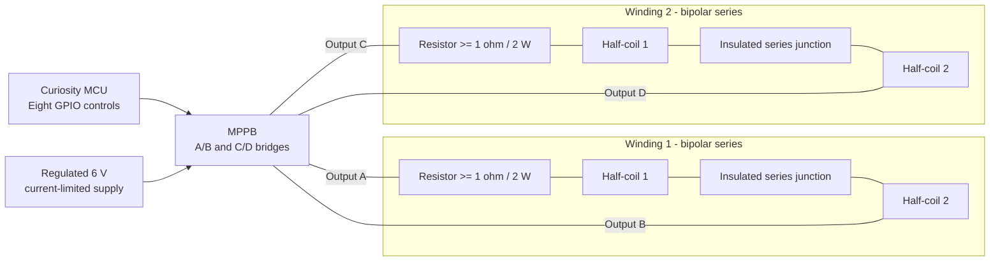
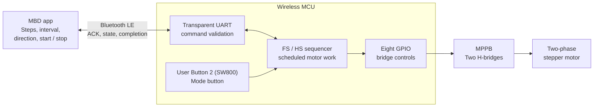
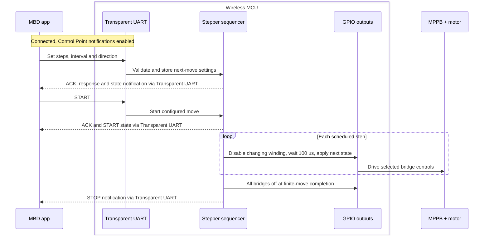

<div align="center">

<h1>Bluetooth® LE Stepper Motor Control</h1>

<p><strong>Wireless step and direction control. Powered by Zephyr®.</strong></p>

<p>Wireless MCU &nbsp; | &nbsp; Bluetooth LE &nbsp; | &nbsp; Full / half stepping &nbsp; | &nbsp; MPPB</p>

<p><a href="#31-prerequisites">Set up Zephyr</a> · <a href="#32-import-the-application">Import</a> · <a href="#34-build-the-application">Build</a> · <a href="#35-program-the-board">Flash</a> · <a href="#5-demo-setup-and-operation">Run with MBD</a></p>

</div>

**Contents**

1. [Introduction](#1-introduction)
2. [Hardware Setup](#2-hardware-setup)
3. [Zephyr Software Setup](#3-zephyr-software-setup)
   - [Prerequisites](#31-prerequisites)
   - [Import the application](#32-import-the-application)
   - [Application configuration](#33-application-configuration)
   - [Build](#34-build-the-application)
   - [Program](#35-program-the-board)
   - [File structure](#36-file-structure)
4. [Application Architecture and Control Principles](#4-application-architecture-and-control-principles)
   - [Control architecture](#41-control-architecture)
   - [Bluetooth LE data flow and commands](#42-bluetooth-le-data-flow-and-commands)
   - [GPIO sequencing and motor control](#43-gpio-sequencing-and-motor-control)
5. [Demo Setup and Operation](#5-demo-setup-and-operation)
6. [Validation and Troubleshooting](#6-validation-and-troubleshooting)


## 1. Introduction

Command step count, direction, step interval and start/stop wirelessly from
the Microchip Bluetooth Data (MBD) app. The PIC32-BZ6 Curiosity board uses the
Microchip Transparent UART Profile over Bluetooth® LE and sequences eight GPIO
controls on the Microchip Multi-Phase Power Board (MPPB).

The example uses a **Leadshine 42HS03 eight-lead, two-phase stepper**. Full-step
(FS) mode provides 200 commanded steps/revolution, and half-step (HS) mode
provides 400. Press Curiosity **User Button 2 (SW800)** to switch modes.

> **Supported board:** PIC32-BZ6 Curiosity only,
> `pic32wm_bz6204_curiosity/pic32cx2051bz62132`.

### Disclaimer

This example is provided **“AS IS”** as a starting point for development and
self-support. Motion is **open-loop**: commanded steps are not measured shaft
position or speed. There is no encoder, homing, stall detection, acceleration
ramp, current-feedback regulator or holding torque at STOP.

Check the electrical ratings, winding connections and actual current before
running the motor. The application uses GPIO sequencing, **not PWM current
regulation**. Do not copy the brushed-DC example's 24 V supply setup.

## 2. Hardware Setup

### Bill of materials

| Item | Quantity | Notes |
| :-- | :--: | :-- |
| [PIC32-BZ6 Curiosity board](https://www.microchip.com/en-us/development-tool/ev31u42a) | 1 | Only supported board: `pic32wm_bz6204_curiosity` |
| Microchip MPPB (EV35Z86A) | 1 | Four half-bridges; A/B drive winding 1, C/D drive winding 2 |
| Leadshine 42HS03 eight-lead stepper | 1 | Identify and connect the half-coils in bipolar series |
| Regulated 6 V external supply | 1 | Series-wound, low-speed bench setup only; approximately 1.5 A supply current limit |
| Series resistors, at least 1 ohm / 2 W each | 2 | One resistor in series with each complete motor winding |
| Jumper wires and USB/debug connection | As needed | C/D bridge controls require four additional jumpers |
| Multimeter / current measurement equipment | As needed | Verify independent coil pairs, series resistance and winding current |

#### Motor and supply ratings

The [42HS03 datasheet](https://ww1.microchip.com/downloads/en/DeviceDoc/Leedshine%2042HS03%20Stepper%20Motor%20Datasheet.pdf)
specifies approximately **4.6 ohms and 1.0 A per half-coil**, **0.7 A RMS in
bipolar series**, and **1.4 A RMS in bipolar parallel**. These are winding
current ratings, not permission to apply 24 V directly to a winding.

For the documented **series-wound, low-speed bench setup**, use 6 V and at least
1 ohm / 2 W in series with each complete winding. At 10% below the nominal
half-coil resistance:

```text
Winding current <= 6 V / (2 × 4.6 ohms × 0.9 + 1 ohm) = 0.647 A
```

Verify the actual winding resistance and current. Set the supply current limit
to approximately 1.5 A and check for heating before sustained operation.
The resistors limit current passively; the firmware does not regulate it.

> ⚠️ **Power and wiring safety**
>
> Do not use the brushed-DC application's 24 V supply with this GPIO-only
> stepper setup. Although the MPPB supports 6–50 V input, the motor windings
> still require current limiting. Higher voltage/speed operation requires a
> verified per-winding chopper regulator or a dedicated current-limited driver.
> Keep supply voltage off MCU signal pins. STOP releases the windings: secure
> mechanisms that could move when holding torque disappears.

### Wiring

Connect and inspect all wiring with power removed. The following table applies
only to Curiosity; these are GPIO outputs, including pins that have alternate
timer/PWM functions.

| Function | PIC32-BZ6 Curiosity pin | MPPB control-header pin | Purpose |
| :-- | :-- | :--: | :-- |
| Drive A High | PA7 / mikroBUS 1 SDA (J903 pin 11) | 26 | Winding 1, A half-bridge high |
| Drive A Low | PA3 / J701 pin 25 (GPIO header) | 25 | Winding 1, A half-bridge low |
| Drive B High | PA1 / mikroBUS 2 RX (J905 pin 14) | 24 | Winding 1, B half-bridge high |
| Drive B Low | PA0 / mikroBUS 2 TX (J905 pin 13) | 23 | Winding 1, B half-bridge low |
| Drive C High | PB10 / J701 pin 2 | 22 | Winding 2, C half-bridge high |
| Drive C Low | PB12 / J701 pin 11 | 21 | Winding 2, C half-bridge low |
| Drive D High | PB11 / J701 pin 13 | 20 | Winding 2, D half-bridge high |
| Drive D Low | PB13 / J701 pin 15 | 19 | Winding 2, D half-bridge low |
| Ground | GND / J701 pin 3 | Pin 40 (GND) | Common control/power reference |
| Status LED | PB7, active low | Not connected to MPPB | Advertising, connection and mode indication |
| Mode button | User Button 2 / SW800 / PE3 (`sw0` alias) | Not connected to MPPB | Toggle FS / HS |

Use the [Curiosity board guide](https://ww1.microchip.com/downloads/aemDocuments/documents/WSG/ProductDocuments/UserGuides/PIC32-BZ6-Curiosity-Board-User-Guide-DS00006006.pdf)
and [MPPB hardware guide](https://ww1.microchip.com/downloads/aemDocuments/documents/MCU08/ProductDocuments/UserGuides/MultiPhase-PowerBoard-HW-UserGuide-DS50003746.pdf)
to verify connector orientation and the hardware revision. J903 is mikroBUS
socket 1; J905 is mikroBUS socket 2; J701 is GPIO header 1. The SDA, RX and TX
pins listed above are used as GPIO outputs, not as I2C or UART signals. Leave QSPI,
graphics and mikroBUS accessories using PB10/11/12/13 disconnected. The four
C/D signals need extra jumper wires on the existing adapter harness.

#### Eight-lead motor connections

1. Identify **four independent half-coil pairs** with a multimeter. Each
   half-coil is nominally 4.6 ohms; unrelated pairs should be open.
2. Pair the correct two half-coils for each phase according to the motor's
   bipolar-series lead diagram. Match magnetic polarity. Each series winding
   should measure approximately 9.2 ohms before adding its resistor.
3. Insulate each internal series junction; do not connect it to an MPPB
   output, ground or supply.
4. Connect winding 1's outer leads to MPPB **A/B**, through its series resistor.
   Connect winding 2's outer leads to MPPB **C/D**, through its separate resistor.
5. Connect regulated 6 V to the MPPB motor-power input and join the required
   control/power grounds. Never connect motor leads directly to the supply
   or MCU GPIO.

Wire colors and a motor serial number do not identify coil polarity. Use the
lead diagram for the actual motor cable. The generic wiring diagram below
shows topology only, not manufacturer lead colors.



## 3. Zephyr Software Setup

### 3.1 Prerequisites

Complete the [Zephyr Wireless environment setup](https://github.com/Zephyr4Microchip/zephyr-wireless#2-environment-setup)
using either supported workflow:

- **Workbench (VS Code):** [Workbench for Zephyr guide](https://github.com/Zephyr4Microchip/zephyr-wireless/blob/main/docs/Workbench_for_Zephyr.md).
- **Command line (CLI):** [Command-line setup instructions](https://github.com/Zephyr4Microchip/zephyr-wireless#legacy-command-line).

Use these guides for host tools, the Microchip Zephyr workspace/modules, SDK,
OpenOCD and CMSIS-DAP programmer-mode setup. This application has been
build-checked with the Microchip Zephyr 4.2.0 workspace and SDK **0.17.4**.
A generic upstream checkout alone does not supply all PIC32-BZ6 components.
The Transparent UART implementation is included in this application's
[`src`](src) directory.

**Supported board:** PIC32-BZ6 Curiosity only — `pic32wm_bz6204_curiosity`,
SoC qualifier `pic32cx2051bz62132`.

#### Setup guide and supporting references

- [Microchip Workbench for Zephyr guide](https://github.com/Zephyr4Microchip/zephyr-wireless/blob/main/docs/Workbench_for_Zephyr.md) — import, SDK selection, build and flash.
- [Zephyr GPIO API](https://docs.zephyrproject.org/4.2.0/hardware/peripherals/gpio.html) — bridge output control.
- [Zephyr workqueues](https://docs.zephyrproject.org/4.2.0/kernel/services/threads/workqueue.html) — scheduled motor sequencing.
- [Microchip AN1307](https://ww1.microchip.com/downloads/aemDocuments/documents/MCU16/ApplicationNotes/ApplicationNotes/Stepper-Motor-Control-with-dsPIC-DSCs-DS00001307B.pdf) — background on the 42HS03 motor and a different, current-regulated controller.

AN1307's dsPIC reference uses parallel windings, 24 V, ADC/PWM current
regulation, acceleration and half/microstepping. Those capabilities are **not**
implemented here; its supply settings must not be copied to this example.

### 3.2 Import the application

#### Clone into the workspace

For the Workbench workflow, clone from the workspace's `applications` directory:

```powershell
git clone https://github.com/MicrochipTech/Bluetooth_LE_Stepper_Motor_Control.git
```

The repository contains application firmware, not Zephyr, its modules, the SDK
or programmer tools.

#### Workbench

Follow [Import existing application in Workbench](https://github.com/Zephyr4Microchip/zephyr-wireless/blob/main/docs/Workbench_for_Zephyr.md#7-import-existing-application).
Select `applications\Bluetooth_LE_Stepper_Motor_Control`, choose
**`pic32wm_bz6204_curiosity`**, qualifier **`pic32cx2051bz62132`** if requested,
and SDK **0.17.4**.

#### CLI

As in the servo and DC guides, clone inside the Zephyr checkout's `samples`
directory. The CLI commands assume the application is at
`~/zephyrproject/zephyr/samples/Bluetooth_LE_Stepper_Motor_Control`.

```bash
cd ~/zephyrproject/zephyr/samples
git clone https://github.com/MicrochipTech/Bluetooth_LE_Stepper_Motor_Control.git
```

See the [Zephyr Wireless CLI workflow](https://github.com/Zephyr4Microchip/zephyr-wireless#legacy-command-line)
for environment and shell setup.

### 3.3 Application configuration

| Layer | Configuration / source | Role |
| :-- | :-- | :-- |
| Bluetooth LE / Transparent UART | [`prj.conf`](prj.conf), [`Kconfig`](Kconfig), [`trs.c`](src/trs.c), [`trs_server.c`](src/trs_server.c) | One BLE connection, CP commands, transparent data and flow control |
| GPIO pin mapping | [Curiosity overlay](boards/pic32wm_bz6204_curiosity.overlay) | Eight `stepper-*` aliases, `led3`, and SERCOM5 disabled to free PA0/PA1 |
| Motor parameters / command IDs | [`app_stepper_motor.h`](src/app_stepper_motor.h) | 6 V UI metadata, 200/400 steps per revolution, default 5 ms interval |
| Bridge sequence / motion | [`app_stepper_motor.c`](src/app_stepper_motor.c) | FS/HS states, dedicated workqueue, bounded/continuous motion and MTU-aware UI response |
| BLE / UART / button integration | [`main.c`](src/main.c) | Advertising, command dispatch, button mode change and LED indication |
| Build / sample metadata | [`CMakeLists.txt`](CMakeLists.txt), [`sample.yaml`](sample.yaml) | Explicit application sources and Curiosity-only build target |

The firmware boots in FS mode. User Button 2 (SW800), mapped to the Zephyr
`sw0` alias, switches the runtime mode; there is no
build-time FS/HS selection in this version. GPIO bridge outputs are configured
inactive at startup.

Bluetooth LE requests ATT MTU 247; the peer negotiates the actual value.
`CONFIG_BT_GATT_CLIENT=y` allows the application to request an MTU exchange
for the stepper UI response.

### 3.4 Build the application

#### Workbench

Follow [Build the application in Workbench](https://github.com/Zephyr4Microchip/zephyr-wireless/blob/main/docs/Workbench_for_Zephyr.md#step8).
Use the selected Curiosity board and SDK. Use a pristine build when switching
applications or reusing an old build directory.

#### CLI

Run from the Zephyr checkout directory using the application under `samples`:

```bash
cd ~/zephyrproject/zephyr
west build -p always -b pic32wm_bz6204_curiosity samples/Bluetooth_LE_Stepper_Motor_Control
```

Zephyr automatically applies the Curiosity overlay. Build output is generated
under `~/zephyrproject/zephyr/build/`. No precompiled image is required.

### 3.5 Program the board

#### Workbench

Follow [Flash the application in Workbench](https://github.com/Zephyr4Microchip/zephyr-wireless/blob/main/docs/Workbench_for_Zephyr.md#step9).
Select the **OpenOCD** runner and configure the supported debug probe as
described in the setup guide.

#### CLI

Flash the build from the previous section:

```bash
cd ~/zephyrproject/zephyr
west flash
```

If OpenOCD reports `unable to find a matching CMSIS-DAP device`, check the USB
cable, debug-probe mode/drivers and other software holding the probe. A
successful build does not mean the new image has been programmed.

### 3.6 File structure

```text
Bluetooth_LE_Stepper_Motor_Control/
|-- README.md
|-- .gitignore
|-- CMakeLists.txt
|-- Kconfig
|-- prj.conf
|-- sample.yaml
|-- boards/
|   `-- pic32wm_bz6204_curiosity.overlay
`-- src/
    |-- main.c
    |-- app_stepper_motor.c
    |-- app_stepper_motor.h
    |-- trs.c
    |-- trs.h
    |-- trs_server.c
    `-- trs_server.h
```

Build output and local VS Code settings are ignored, matching the servo
repository.

## 4. Application Architecture and Control Principles

### 4.1 Control architecture

| At a glance | Application behavior |
| :-- | :-- |
| Advertising name | `Zephyr_Stepper_Motor` |
| UI name | `Stepper Motor - FS` or `Stepper Motor - HS` |
| Startup | FS, 200 configured steps, 5 ms/step, CW, stopped |
| Resolution | FS: 200 steps/revolution (1.8°); HS: 400 (0.9°) |
| Finite move | Configured step count at the selected interval, then all bridges off |
| Continuous mode | Delay 0; nominal 1 ms interval until STOP, step count ignored |
| Mode change | User Button 2 (SW800) toggles FS/HS, resets configured steps to 200/400, stops an active move |
| Feedback | Command state / completion notifications; no physical motion sensor |
| Power-stage control | Eight GPIO outputs; no PWM current regulation |

Diagrams use generic functional signals. The [hardware table](#2-hardware-setup)
defines the actual Curiosity pin mapping.



### 4.2 Bluetooth LE data flow and commands

#### From a step request to motion



ACKs and completion report software execution, not confirmed shaft motion.

#### Transport and command frames

Motor commands belong on the Transparent UART **Control Point (CP)**.
Enable CP notifications before writing commands. RX data forwards transparent
bytes to UART; it does not execute stepper commands. TX notifications carry
UART-originated transparent data.

```text
8E | LENGTH | COMMAND_ID | COMMAND_DATA
```

`LENGTH` counts the command ID and data bytes. Multi-byte step counts and
intervals are unsigned 16-bit **big-endian**. Direction and start/stop are
one-byte fields.

| Request | Raw example | ACK | Response / notification |
| :-- | :-- | :-- | :-- |
| Read UI/state | `8E 01 A1` | `8E 01 D1` | `B1` UI update after sufficient MTU |
| Configure 200 steps | `8E 03 A6 00 C8` | `8E 01 D6` | `8E 03 B6 00 C8`, `8E 03 C6 00 C8` |
| Configure 50 ms/step | `8E 03 A7 00 32` | `8E 01 D7` | `8E 03 B7 00 32`, `8E 03 C7 00 32` |
| Configure CW | `8E 02 A4 00` | `8E 01 D4` | `8E 02 B4 00`, `8E 02 C4 00` |
| Configure CCW | `8E 02 A4 01` | `8E 01 D4` | `8E 02 B4 01`, `8E 02 C4 01` |
| START | `8E 02 A5 01` | `8E 01 D5` | `8E 02 B5 01`, `8E 02 C5 01` |
| STOP | `8E 02 A5 00` | `8E 01 D5` | `8E 02 B5 00`, `8E 02 C5 00` |
| Configure continuous mode | `8E 03 A7 00 00` | `8E 01 D7` | Delay 0 selects continuous mode on the next START |

Step count is 1–65535. Nonzero delay is 1–65535 ms **between steps**, not total
move duration. Step count and delay changes during a move apply to the next
move. Changing direction during motion stops it; another START is required.
Finite completion sends `8E 02 C5 00`.

#### UI response layout

```text
8E | LENGTH | B1 | NAME_LENGTH | NAME |
VOLTAGE_H L | STEPS_PER_REV_H L | STEP_COUNT_H L | DELAY_MS_H L | DIRECTION | START_STOP
```

Default FS response:

```text
8E 1E B1 12 53 74 65 70 70 65 72 20 4D 6F 74 6F 72 20 2D 20 46 53 00 06 00 C8 00 C8 00 05 00 00
```

It reports `Stepper Motor - FS`, 6 V, 200 steps/revolution, 200 configured
steps, 5 ms/step, CW and STOP. HS changes the name suffix to `HS` and reports
400 steps/revolution with 400 configured steps after a mode toggle.
`LENGTH` is 0x1E (30); the full frame is 32 bytes. This needs an **ATT MTU of
at least 35** for a CP notification. After A1, the application requests MTU
exchange if needed. If the peer refuses a sufficient MTU, B1 is not delivered;
check the MTU error log.

### 4.3 GPIO sequencing and motor control

This application does not use a STEP/DIR driver or PWM speed/current control.
The MCU directly selects the eight MPPB high/low controls.

| FS state | Winding 1 (A/B) | Winding 2 (C/D) |
| :--: | :-- | :-- |
| 0 | A High + B Low (+) | C High + D Low (+) |
| 1 | B High + A Low (-) | C High + D Low (+) |
| 2 | B High + A Low (-) | D High + C Low (-) |
| 3 | A High + B Low (+) | D High + C Low (-) |

CW traverses the states in forward order; CCW in reverse. HS inserts four
one-winding states between the two-winding states. Each changing winding is
disabled for **100 us** before its new state is applied; unchanged windings
stay energized.

Approximate commanded speed for a nonzero interval:

```text
RPM = 60,000 / (steps_per_revolution × interval_ms)
```

| Interval | Nominal FS speed | Nominal HS speed |
| --: | --: | --: |
| 50 ms | 6 RPM | 3 RPM |
| 10 ms | 30 RPM | 15 RPM |
| 5 ms (default) | 60 RPM | 30 RPM |

These are **commanded timing estimates**, not measured speed. Scheduling and
Bluetooth traffic may extend the move; missed steps may reduce actual travel.
Finite steps use monotonic-clock deadlines with at least 1 ms between scheduled
steps. Continuous mode uses nominal 1 ms intervals; it has no acceleration
ramp and is not guaranteed to reach its theoretical speed.

At STOP, finite completion or a mode change during motion, all bridges turn
off. There is no holding torque. HS torque varies between one- and two-winding
states because no current regulation compensates the difference.

## 5. Demo Setup and Operation

| Step | Action | Expected behavior |
| :--: | :-- | :-- |
| 1 | With power removed, verify coil pairs, series junctions, resistors and all eight control wires | Two independent series windings and correct A/B/C/D connections |
| 2 | Program Curiosity and apply the verified bench supply | FS mode, motor stopped, advertising as `Zephyr_Stepper_Motor` |
| 3 | Connect MBD and enable CP notifications | Commands and state responses can reach the app |
| 4 | Request UI/state | `Stepper Motor - FS`; MTU exchange if needed |
| 5 | Set 200 steps, CW and **50 ms/step**, then START | One nominal FS revolution, approximately 10 seconds, then coast |
| 6 | STOP, check winding current/temperature, then test CCW | Opposite direction without excessive current or heating |
| 7 | Press User Button 2 (SW800) | Double LED blink; HS mode, configured steps reset to 400; START required again |
| 8 | Request/check HS UI and run 400 steps at 50 ms/step | One nominal HS revolution, approximately 20 seconds, then coast |

Begin with a longer step interval, not continuous mode or the shortest delay.
Increase speed only after checking winding current, supply limiting, heating,
resonance and missed steps. There is no acceleration ramp.

For a manual BLE client, write the hexadecimal frames in the command table to
CP. Do not send them as ASCII strings or through transparent RX.

> ⚠️ **Disconnection is not STOP**
>
> Bluetooth LE disconnection detaches notifications but does not stop motion.
> A finite move continues to completion; continuous motion continues until
> stopped by a supported local action or reconnected STOP command. Send STOP
> before disconnecting. User Button 2 (SW800) stops an active move while changing mode.

## 6. Validation and Troubleshooting

The copied firmware preserves the existing application's behavior. A successful
build checks compilation, not current limits, coil polarity, actual travel or
safe mechanical operation. Validate those on the actual hardware.

| Check | Expected result |
| :-- | :-- |
| Startup | FS, 200 steps configured, 5 ms interval, CW, stopped |
| FS/HS button | Stops active motion, double blink, UI name and steps/revolution updated |
| GPIO routing | All eight pins match the hardware table and overlay |
| Winding current | Within the motor's series-winding rating under the documented supply arrangement |
| Bounded motion | Configured number of state advances, then all outputs inactive |
| Direction | Shaft direction agrees with CW/CCW after correct winding polarity |
| UI exchange | B1 received with ATT MTU >= 35 |
| Completion | STOP notification; no winding hold after motion |

| Symptom | Check |
| :-- | :-- |
| Vibrates without rotating | Identify half-coil pairs, phase grouping/series polarity and A/B/C/D jumpers; stop before changing wiring |
| Supply limits current or motor heats | Stop and check actual winding current, series resistors, resistance and 6 V supply; no active current regulation exists |
| Motion loses steps at short delays | Lengthen interval, reduce load and check resonance; there is no acceleration ramp or stall feedback |
| Only one phase works | Check the four extra C/D jumpers and disconnect conflicting accessories on PB10/11/12/13 |
| Direction is reversed | With power off, reverse the two outer leads of one complete winding and verify again |
| B1 UI response missing | Enable CP notifications; peer must negotiate ATT MTU >= 35 |
| Mode button has no effect | Use User Button 2 (SW800); confirm the current image, `sw0` mapping to PE3, button interrupt and mode logs |
| Changed count/delay does not affect running move | Those settings apply to the next START |
| Motor continues after disconnect | Expected open-loop behavior; disconnect is not a hardware stop |
| No holding torque after STOP | Expected: all bridges off |
| OpenOCD cannot find CMSIS-DAP | Check probe mode, USB, drivers and probe ownership; flashing did not complete |

Hardware images and demo video can be added later; no placeholder assets or
unverified demonstration links are included.
